# Retr0 Academy on NEAR

> **Why NEAR:** readable accounts (`you.near`), sub-accounts that prove who deployed a contract, cheap storage staking and signed messages let a course certificate be a real, verifiable, useful credential, not a PDF.

<p align="center">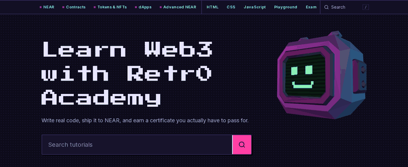</p>

**A Web3 developer school whose certificate is earned, verified on chain, and actually does something.**
Learn NEAR through visual, runnable lessons, pass a hard server-graded final exam, and mint a soulbound **NEAR Developer Certificate** (NEP-171) **on NEAR mainnet** that unlocks holder-only content through a server-side, wallet-signed check.

Built at **NEAR HACKATHON** (Nov 2026). Tracks: **NFTs That Do Something** (`nfts`, primary: the NFT is a credential and an access right) and **Open Innovation** (`open`).

| | |
| --- | --- |
| Live site | https://retr0school-near.vercel.app |
| Code E (full playground) | https://code-e-near.vercel.app |
| **Certificate contract (mainnet)** | [`diploma.hlpok1lad.tg`](https://nearblocks.io/address/diploma.hlpok1lad.tg) (code hash `HqMRoXpT…xmpFVq`, same audited Wasm as the beta) |
| Mainnet deploy + init | [`7rDfYmYFKHi2fZKzorCR849FK8Uym1vvHEGAZNQHX1nE`](https://nearblocks.io/txns/7rDfYmYFKHi2fZKzorCR849FK8Uym1vvHEGAZNQHX1nE), track + grader key [`AKxNJeci…cKRq`](https://nearblocks.io/txns/AKxNJecismXPh8JcY8wXKsksGPNTmKMVxvdsy1RrcKRq) |
| **Mainnet certificate** minted from a passed final exam (40/40, A+) | token `near:hlpok1lad.tg`, tx [`FDK7A2FjUgwfPrUHiFcxxMe4V3JisY1toBopS4HnsoXU`](https://nearblocks.io/txns/FDK7A2FjUgwfPrUHiFcxxMe4V3JisY1toBopS4HnsoXU) · [verify page](https://retr0school-near.vercel.app/verify/hlpok1lad.tg) |
| Beta contract (testnet, still verifiable) | [`diploma.retr0school.testnet`](https://testnet.nearblocks.io/address/diploma.retr0school.testnet), example mint [`MoTocnN8…3Ce`](https://testnet.nearblocks.io/txns/MoTocnN8iUHtDVSujzBxm2JPNShC5owBpc5y1Zuo3Ce), upgrade [`AokmCfpN…gtNq`](https://testnet.nearblocks.io/txns/AokmCfpNTvEV42QcptTr6cE9j3NRihwehPJn54oNgtNq) |
| Final exam | https://retr0school-near.vercel.app/near/quiz |
| Verify a developer (certificate + shipped contract) | https://retr0school-near.vercel.app/verify/hlpok1lad.tg (mainnet) · [beta example](https://retr0school-near.vercel.app/verify/demo-learner.retr0school.testnet) |
| Ship-to-chain final project | https://retr0school-near.vercel.app/dapp/ship-to-chain |
| AI tutor | the **Ask AI** button on every page (off during the final exam) |
| Leaderboard | https://retr0school-near.vercel.app/leaderboard |
| **Mainnet proof (live)** | https://retr0school-near.vercel.app/proof · JSON: [/api/proof](https://retr0school-near.vercel.app/api/proof) |
| Security | red-team round 1: all findings fixed and documented in [docs/security/retr0-academy-r1-fixes.md](docs/security/retr0-academy-r1-fixes.md) · [SECURITY.md](SECURITY.md) |

<p>
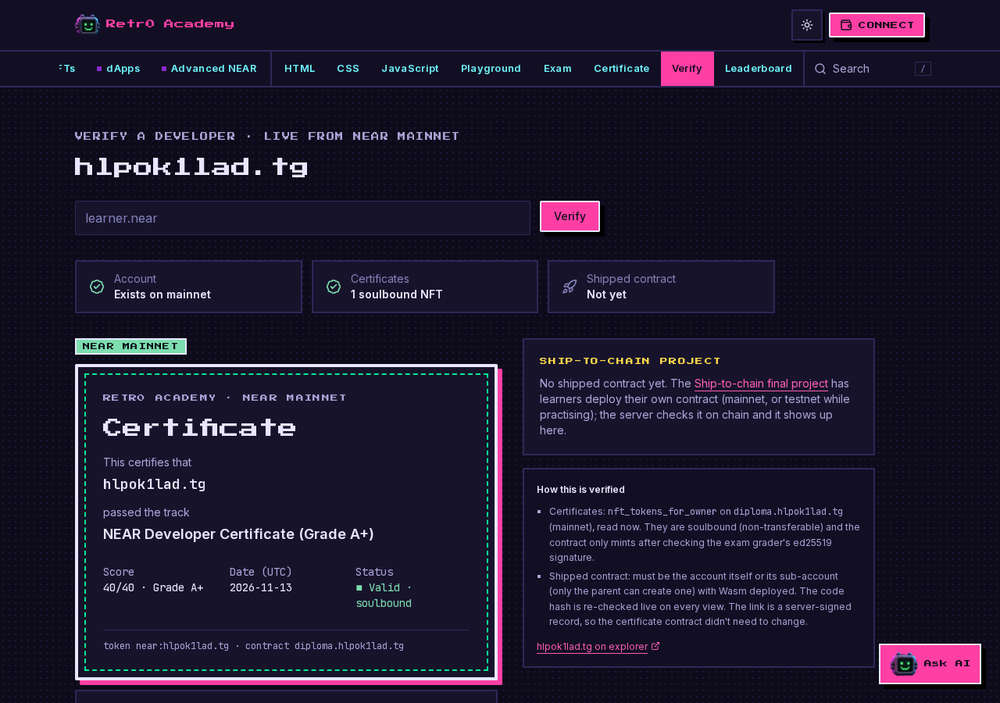
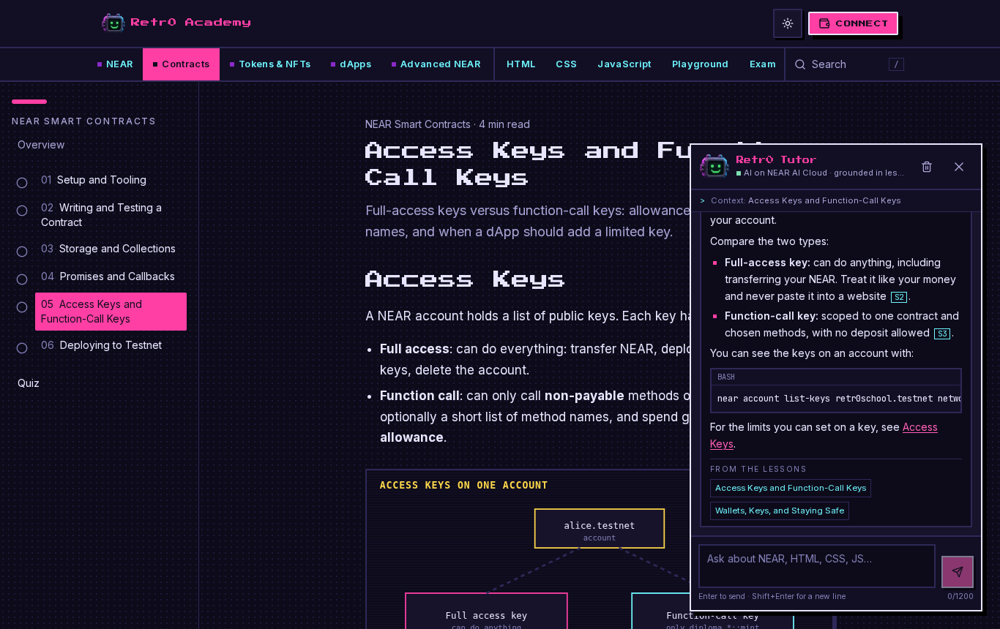
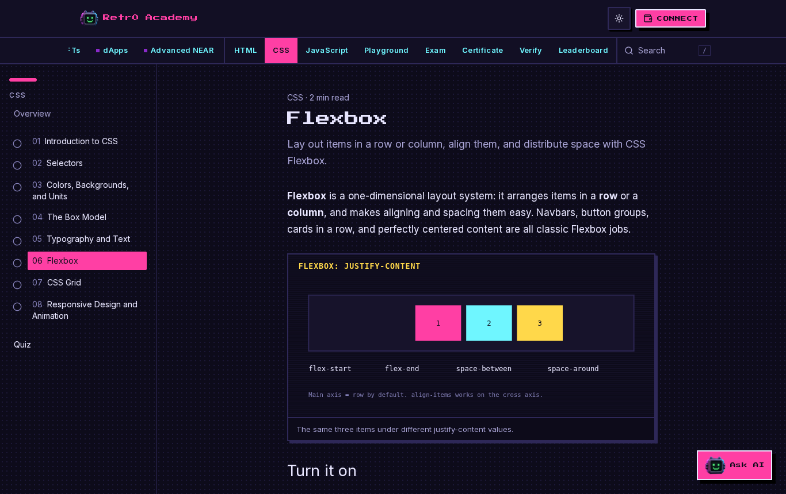
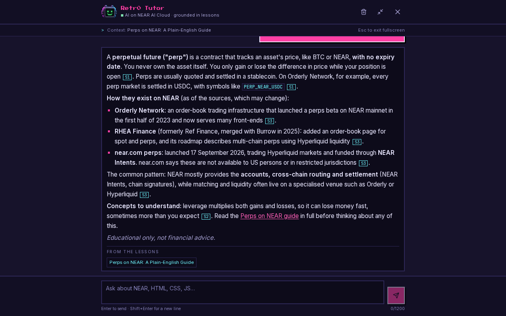
</p>

<p>
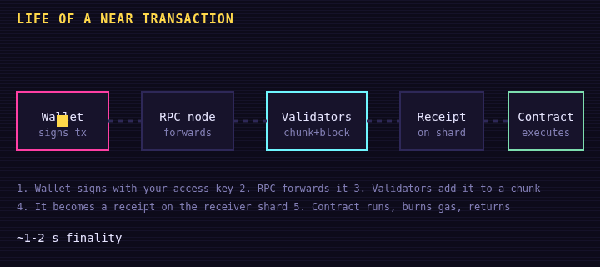

</p>

## Mainnet proof

Everything below is on NEAR mainnet and checkable by anyone. The live page [retr0school-near.vercel.app/proof](https://retr0school-near.vercel.app/proof) reads it from public NEAR RPC and the NearBlocks indexer every 5 minutes. It re-checks each transaction's final status on an archival RPC node and falls back to a committed snapshot (`apps/retr0school/data/proof-snapshot.json`) if either source is down.

| What | On chain |
| --- | --- |
| Certificate contract | [`diploma.hlpok1lad.tg`](https://nearblocks.io/address/diploma.hlpok1lad.tg), NEP-171/177/181, symbol `R0DIPLOMA`, code hash `HqMRoXpTbZWAnr7EhrKi4G3d7vLwfN1VXFX26NxpmFVq` |
| Attestor key (`get_attestor`) | `ed25519:ALwa4U2nDdfMtYGfHBDwW9bgydB8eEdMbiNggP4z6XU6` |
| Track (`get_tracks`) | `near`: NEAR Developer Certificate, 40 points, pass mark 32 |
| Certificates minted (`nft_total_supply`, 14 Nov 2026) | **1**: `near:hlpok1lad.tg`, 40/40, grade A+, soulbound ([token](https://nearblocks.io/nft-token/diploma.hlpok1lad.tg/near%3Ahlpok1lad.tg), [live verify](https://retr0school-near.vercel.app/verify/hlpok1lad.tg)) |
| Mint (`mint_diploma`, NEP-171 `nft_mint` event) | [`FDK7A2FjUgwfPrUHiFcxxMe4V3JisY1toBopS4HnsoXU`](https://nearblocks.io/txns/FDK7A2FjUgwfPrUHiFcxxMe4V3JisY1toBopS4HnsoXU): Success |
| Track + attestor setup (`set_track`, `set_attestor`) | [`AKxNJecismXPh8JcY8wXKsksGPNTmKMVxvdsy1RrcKRq`](https://nearblocks.io/txns/AKxNJecismXPh8JcY8wXKsksGPNTmKMVxvdsy1RrcKRq): Success |
| NEAR transfer to the contract (storage funding) | [`GseuxnfTTysWbyXSE863cbcisciaS6QHfZf6tpD2e7mS`](https://nearblocks.io/txns/GseuxnfTTysWbyXSE863cbcisciaS6QHfZf6tpD2e7mS): Success |
| Create + deploy + `new` | [`7rDfYmYFKHi2fZKzorCR849FK8Uym1vvHEGAZNQHX1nE`](https://nearblocks.io/txns/7rDfYmYFKHi2fZKzorCR849FK8Uym1vvHEGAZNQHX1nE): Success |

All 4 transactions to the contract were confirmed `SuccessValue` with no failed receipts via `EXPERIMENTAL_tx_status` on an archival mainnet RPC node (14 Nov 2026). Soulbound: `nft_transfer` and `nft_transfer_call` always panic (contract tests `soulbound_transfer`, `soulbound_transfer_call`).

```bash
near view diploma.hlpok1lad.tg nft_total_supply '{}' --networkId mainnet
near view diploma.hlpok1lad.tg verify_diploma '{"account_id":"hlpok1lad.tg","track":"near"}' --networkId mainnet
```

<p align="center">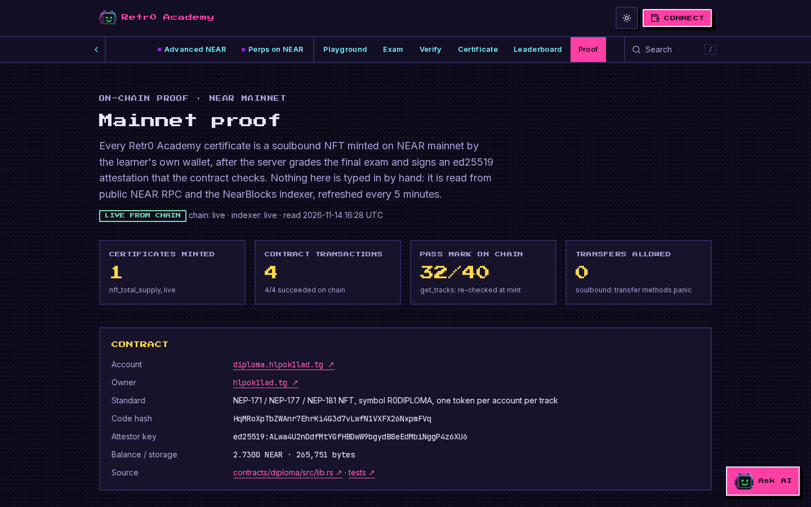</p>

## Screenshots

Live site: [retr0school-near.vercel.app](https://retr0school-near.vercel.app). Captured 14 Nov 2026 (Europe/Budapest).

<p align="center">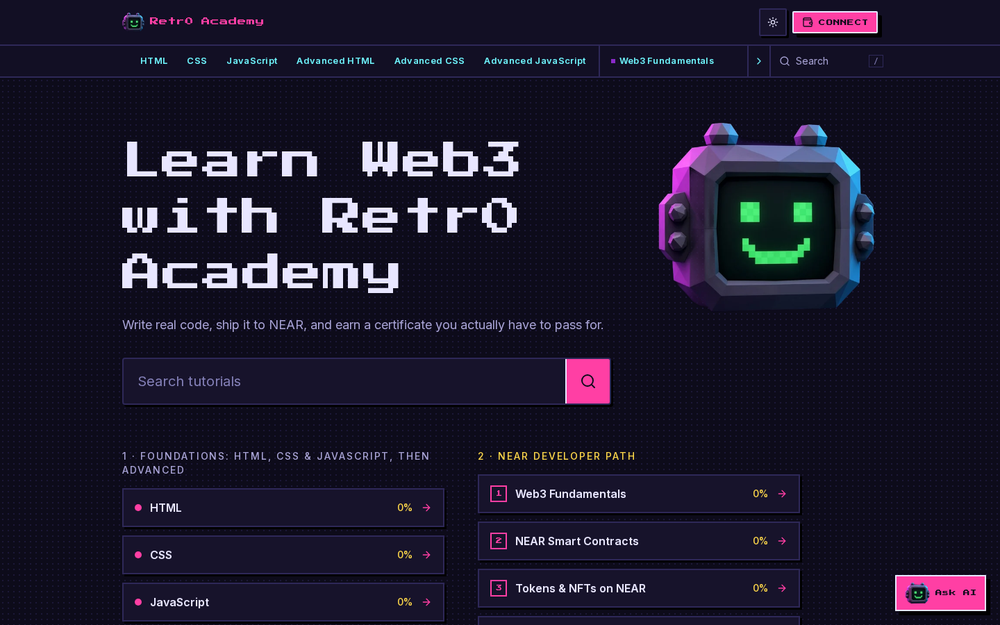</p>

Homepage: the 3D hero robot, foundations courses, and the NEAR Developer path.

<p align="center">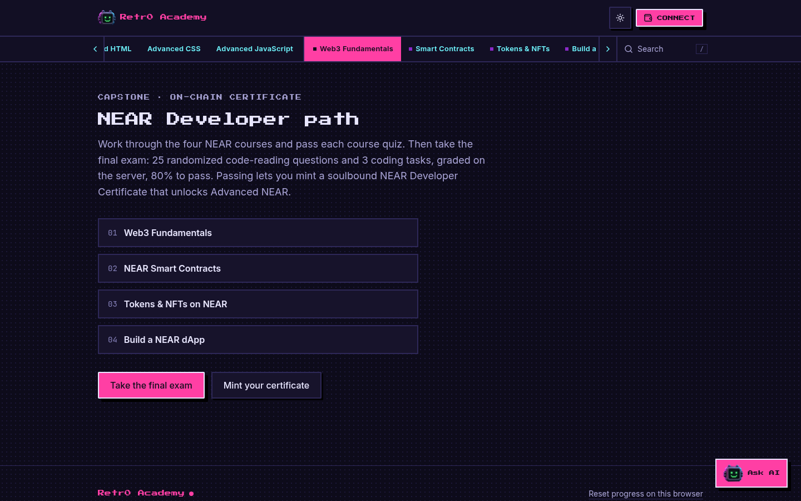</p>

NEAR Developer path: four courses, then the server-graded final exam and certificate mint.

<p align="center">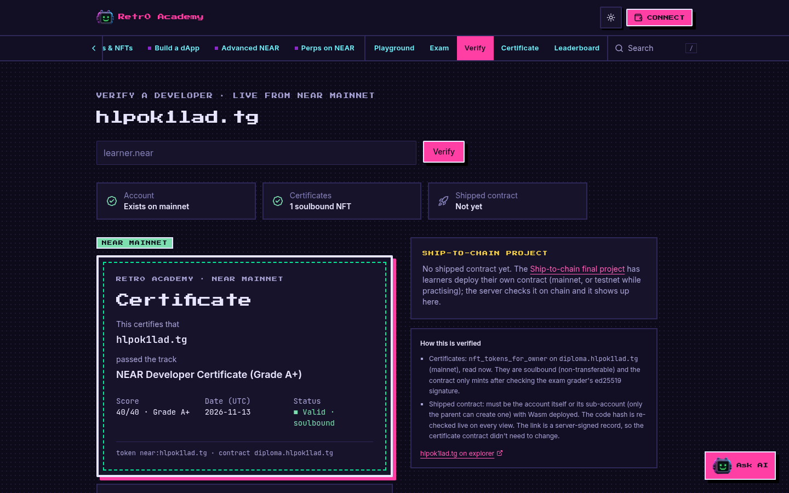</p>

Public verify page for `hlpok1lad.tg`: a soulbound NEAR Developer Certificate (40/40, A+) read from `diploma.hlpok1lad.tg` on mainnet.

<p align="center">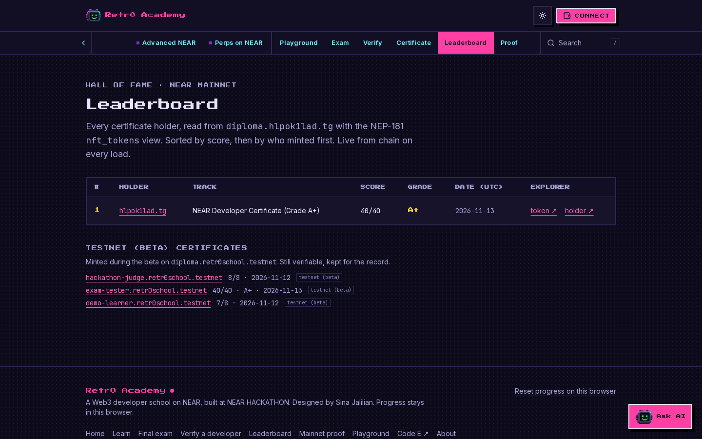</p>

Leaderboard of certificate holders, enumerated on-chain from the diploma contract.

<p align="center">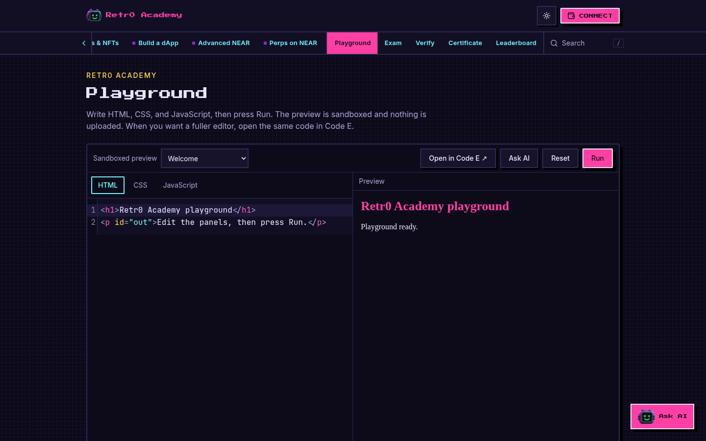</p>

In-browser playground: HTML, CSS, and JavaScript with a sandboxed preview, plus a handoff to Code E.

<p align="center">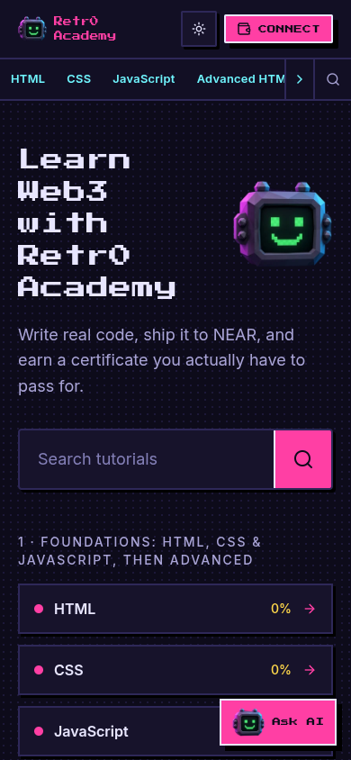</p>

Mobile homepage (390×844).

## Promo video

<!-- PROMO_VIDEO_SLOT: keep this heading. Replace the placeholder line below with a 16:9 embed (or a link to the file) when the final render is ready. The 9:16 cut is for the X submission post. Do not delete these markers. -->

_Official 16:9 demo video will be embedded here._

<!-- /PROMO_VIDEO_SLOT -->

## The problem

Online course certificates prove nothing. A PDF or a database badge can be faked, sold or shared, nobody can check it without trusting the issuer, and most "Web3 courses" end with a multiple-choice quiz you can pass by guessing. Beginners also juggle docs, an editor and a wallet with no clear path.

## The solution

1. **A clear NEAR Developer path** (subject bar and homepage, in order): Web3 Fundamentals (7 lessons) → NEAR Smart Contracts (6) → Tokens & NFTs on NEAR (3) → Build a NEAR dApp (5, ending with the **Ship-to-chain** final project) → **Final exam** → certificate → **Advanced NEAR** (7 holder-only deep dives: cross-contract calls, storage staking, Chain Signatures, Intents, testing contracts, near-api-js + Wallet Selector + NEP-413, deploying to mainnet).
2. **Visual, runnable lessons.** 22 original looping animated diagrams (transaction flow, access keys, cross-contract promises, storage staking, NEP-171 mint events, Chain Signatures, Intents, the event loop, the box model, Grid, and more) and editable examples in every lesson that run in the browser, open in the Playground, and hand off to Code E.
3. **Supporting foundations:** HTML, CSS, JavaScript (8 lessons each) and new **Advanced HTML** (4: semantics and accessibility, forms and validation, media/canvas/SVG, meta/SEO), **Advanced CSS** (4: Grid and Flexbox, custom properties and theming, animations, responsive and container queries) and **Advanced JavaScript** (5: async/await and fetch, ES modules, DOM events and patterns, closures and the event loop, a mini app that reads live NEAR testnet data). Every course has a course page, ordered lessons, Previous/Next, progress tracking and a quiz.
4. **A hard final exam** that gates the certificate:
   - unlocks after the four core NEAR course quizzes are passed (70%+);
   - 25 questions drawn at random from a **67-question bank** (5 per area), mostly code-reading, predict-the-output and debugging; options are re-shuffled every attempt;
   - **3 coding tasks** (yoctoNEAR formatting with BigInt, NEAR account-id validation, NEP-297 event log parsing) auto-graded on the server against visible and hidden tests in a **QuickJS WebAssembly sandbox** (no fs, network or process; memory cap; per-test deadline);
   - 40 points total, **pass mark 32/40 (80%)**, grade A+ / A / B; **40-minute timer** enforced by the server; **30-minute cooldown** after a failed attempt; replayed submissions are rejected;
   - the answer key and hidden tests never reach the browser. The bank is committed only **AES-256-GCM encrypted** (`apps/retr0school/exam/bank.enc.json`) and decrypted on the server with `EXAM_BANK_KEY`; the exam session is a sealed token, so the client cannot see the option shuffle;
   - a score breakdown per topic and per test (per-question right/wrong is deliberately not shown, so repeated attempts can't map the answer key);
   - a pass is bound to **one account**: the account connected at grading time, or the first account it is exchanged for. Visible tests only earn points together with hidden tests.
5. **The certificate contract** (`contracts/diploma`, Rust, near-sdk 5): NEP-171 + 177 + 181 + NEP-297 events. `mint_diploma` verifies the grader's **ed25519 attestation** (`env::ed25519_verify`) over `contract|caller|track|score|max|expiry`, the expiry and the on-chain pass mark (32/40), then mints a **soulbound** token (transfers always panic), one per account. The token stores the score and the **letter grade** in `extra`, title and description.
6. **The NFT does something:** Advanced NEAR is **locked on the server**. The learner signs a free NEP-413 message in their wallet; `/api/holder` verifies the signature, confirms with `view_access_key` that the key is a full-access key of that account, calls `verify_diploma`, and sets a signed HttpOnly cookie. Lesson bodies are only rendered for holders.
7. **Abuse limits:** `/api/grade`, `/api/exam/start`, `/api/holder`, `/api/ship`, `/api/tutor` and the diploma image are rate-limited per client IP (Vercel's edge-set IP). Single-use decisions (exam attempt used, pass bound to an account, NEP-413 nonce burned) are atomic set-if-absent markers in Vercel Blob that fail closed. The tutor only answers this site's own origin.
8. **Verify and share:** `/verify/<account>` (no wallet: certificates via `nft_tokens_for_owner` plus the shipped contract), `/leaderboard` (NEP-181 enumeration), `/d/<account>` share page whose X card is the certificate art (`/api/diploma/near/<account>`).

## NEAR technology used

| NEAR feature | Where |
| --- | --- |
| NEP-171 / 177 / 181 NFT standards, NEP-297 events | `contracts/diploma/src/lib.rs` |
| `env::ed25519_verify` attestations bound to the caller | `mint_diploma` |
| Soulbound credential (transfer panics) | `nft_transfer`, `nft_transfer_call` |
| In-place contract upgrade preserving state + owner `rebrand` data fix | `migrate`, `rebrand`, tx `AokmCfpN…`, `H6Aebs23…` |
| Storage staking paid by the learner (refunded deposit) | `internal_mint_with_refund` |
| Wallet Selector v10 (MyNearWallet, Meteor), function-call access keys | `components/near/wallet-provider.tsx` |
| NEP-413 signed messages + `view_access_key` | `lib/holder.ts`, `app/api/holder` |
| JSON-RPC view calls (`verify_diploma`, `nft_tokens`, `view_account`) via FastNEAR mainnet RPC | verify page, leaderboard, lessons, mini app |
| Named accounts + sub-accounts on mainnet | the credential reads `alice.near`; the contract is `diploma.hlpok1lad.tg`, a sub-account of the builder's account |
| Sub-accounts as proof of authorship + `view_account` code hash | Ship-to-chain check, `lib/ship.ts`, `/api/ship` |
| NEAR AI Cloud (OpenAI-compatible inference) | Retr0 Tutor, `app/api/tutor/route.ts` |

## Architecture

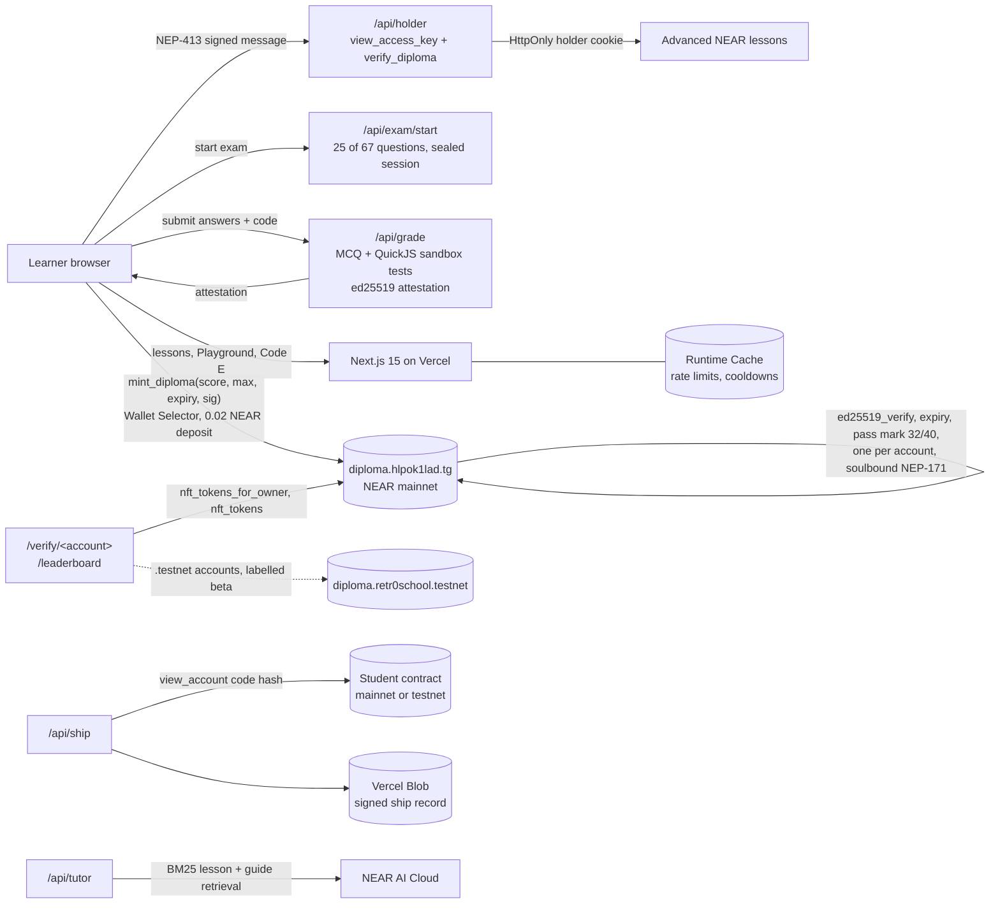

The grader keys live only in Vercel env vars (`NEAR_ATTESTOR_SEED_MAINNET` for mainnet). The contract stores only the public key and checks every mint against it.

## Try it: steps for judges and AI screeners

No install needed. Certificates are on **NEAR mainnet**; lesson examples use testnet so learners can practise for free.

1. Open https://retr0school-near.vercel.app → the hero "Learn Web3 with Retr0 Academy" with the 3D low-poly CRT robot (it follows your cursor, blinks; click it to open the AI tutor), the search bar, then the numbered **NEAR Developer path**, **Final exam → NEAR Developer Certificate**, **Advanced NEAR**, and **Foundations**.
2. Use the **subject bar** under the header, ordered as a learning path in three groups: HTML · CSS · JavaScript · Advanced HTML · Advanced CSS · Advanced JavaScript | Web3 Fundamentals · Smart Contracts · Tokens & NFTs · Build a dApp · Advanced NEAR · Perps on NEAR | Playground · Exam · Verify · Certificate · Leaderboard, plus Search. Each subject opens its course; on lesson pages the left sidebar lists that course's lessons. Drag it with the mouse, use the ◀ ▶ edge buttons, swipe on touch, or Tab/arrow keys; the active subject is scrolled into view.
3. Open https://retr0school-near.vercel.app/contracts/promises-and-callbacks → an animated cross-contract diagram plays above the lesson text.
4. Open https://retr0school-near.vercel.app/js-advanced/mini-app-near-explorer → the example queries NEAR testnet live and shows `hackathon-judge.retr0school.testnet` with its certificate. Press **Open in Playground**, then **Open in Code E**.
5. Open https://retr0school-near.vercel.app/near/quiz → the rules and the prerequisite checklist. No wallet and no time? Press **Try a practice paper** → a 5-question paper with the 3 coding tasks, graded by the same server code (it cannot earn a certificate). Pass the four course quizzes (`/fundamentals/quiz`, `/contracts/quiz`, `/tokens/quiz`, `/dapp/quiz`) with 70%+ → **Start the final exam** → a 40:00 timer, 25 questions with code snippets, 3 coding tasks with **Run visible tests**.
6. Submit → the server returns your score, percent, grade, per-topic bars, per-question marks and per-test results. View the page source or network tab: no answers or hidden tests are ever sent. Fail → a 30-minute cooldown starts.
7. Pass → **Connect wallet** (a NEAR **mainnet** wallet: MyNearWallet or Meteor) → **Mint** → approve `mint_diploma` (0.02 NEAR deposit, unused part refunded, plus a little gas) → the certificate card shows score and grade; `/verify/<you>` shows it to anyone.
8. Open https://retr0school-near.vercel.app/advanced/testing-contracts without a holder session → a locked teaser; the lesson body is not in the HTML (`curl -s …/advanced/testing-contracts | grep mint_end_to_end` → nothing). With a holder wallet press **Unlock with signature** → sign the free NEP-413 message → the server renders the lesson.
9. Press **Ask AI** (bottom right) on https://retr0school-near.vercel.app/contracts/access-keys → ask "What is a function-call key?" → a streamed answer with `S1` citation chips and "From the lessons" links. Open `/playground`, break the JS (e.g. `consol.log(1)`) → **Explain my error** → the tutor reads your code and console. Ask it for final exam answers → it refuses and teaches the concept. Open `/near/quiz` → the tutor button is gone.
10. Open https://retr0school-near.vercel.app/verify/hlpok1lad.tg → the **NEAR mainnet** certificate (40/40, A+, token `near:hlpok1lad.tg`, nearblocks link). Open https://retr0school-near.vercel.app/verify/demo-learner.retr0school.testnet → a **testnet (beta)** certificate and **Shipped: demo-learner.retr0school.testnet** with its live `get_greeting()` result. Try `nobody-here-123.near` → a clear "no certificate" state.
11. Open https://retr0school-near.vercel.app/dapp/ship-to-chain → six guided steps (sub-account, Rust contract, build/deploy with init, call, browser check, submit) → enter an account + contract → **Verify on chain** → the server checks the chain and it appears on `/verify/<you>`.

CLI checks:

```bash
# the mainnet certificate minted from a passed exam (score 40/40, grade A+)
near contract call-function as-read-only diploma.hlpok1lad.tg verify_diploma \
  json-args '{"account_id":"hlpok1lad.tg","track":"near"}' network-config mainnet now
near contract call-function as-read-only diploma.hlpok1lad.tg get_tracks json-args '{}' network-config mainnet now
# -> [{"id":"near","title":"NEAR Developer Certificate","questions":40,"pass_score":32}]

# start an exam (returns questions without answers, and a sealed session token)
curl -s -X POST https://retr0school-near.vercel.app/api/exam/start | head -c 600
```

## AI Tutor (Retr0 Tutor)

An AI tutor that lives on every page, in the same retro look (pixel font, hard shadows, the low-poly CRT robot as its avatar).

- **Streams answers** from **NEAR AI Cloud** (`https://cloud-api.near.ai/v1`, OpenAI-compatible). Default model `anthropic/claude-haiku-5-5`, automatic fallback to `openai/gpt-6-luna` (`TUTOR_MODELS`). The key is the `NEAR_AI_API_KEY` server env var and never reaches the browser.
- **Grounded in the course:** every public lesson is split into sections and ranked with BM25 for each question (`lib/tutor/knowledge.ts`). The top sections go into the prompt; the answer cites them as `[S1]` chips and lists "From the lessons" links.
- **Context-aware:** it knows the lesson you're reading (that lesson is boosted) and suggests matching prompts. In the Playground, **Explain my error** / **Ask AI** sends your HTML/CSS/JS and console errors. Code E has an **Ask AI ↗** button that opens the project in the Playground with the tutor already explaining the error (`/playground?tutor=explain&err=…#code=…`).
- **Can't be used to cheat:** quiz files, the encrypted exam bank and holder-locked lessons are never put in its context (only `content/**/*.mdx` is traced into the function). The system prompt refuses exam/quiz answers and teaches the concept instead. The button is hidden on `/near/quiz`, and `/api/tutor` rejects requests from the exam path.
- **Built to stay up to 25 Nov:** 1,200-character question cap, last 8 messages only, 700 output tokens; per-IP limits (10 per 2 minutes, 80 per day) plus a global daily cap (`TUTOR_DAILY_CAP`, default 5,000) in the Vercel Runtime Cache.
- **No Lighthouse cost:** only the small button ships with the page. The panel loads on first click.
- **Fullscreen mode:** the expand button next to close makes the chat fill the screen on desktop and mobile, with a centered reading column. Collapse with the same button or press Esc; a second Esc closes the panel. The choice is remembered for the browser session.
- **Perps on NEAR guide** (`/guides/perps-on-near`, `content-guides/perps-on-near.mdx`): a sourced background guide covering perpetual futures basics (long/short, leverage, margin, liquidation, funding, mark vs index price, oracles, risks) and how perps exist around NEAR (Orderly Network, RHEA Finance (formerly Ref Finance), near.com perps through NEAR Intents, Pyth's `pyth-oracle.near`). The tutor retrieves it for perps questions, never recommends trades, and ends those answers with "Educational only, not financial advice." Facts were checked against the linked sources on 13 Nov 2026.

```bash
curl -N https://retr0school-near.vercel.app/api/tutor -H 'content-type: application/json' \
  -d '{"path":"/contracts/access-keys","messages":[{"role":"user","content":"What is a function-call key?"}]}'
# -> streamed plain text; headers x-tutor-model and x-tutor-sources (lessons used)
```

## Ship to chain and Verify a developer

- **Final project** `/dapp/ship-to-chain`: the learner creates `hello.<you>.testnet` (or `hello.<you>.near` on mainnet), writes a small Rust contract (`contracts/hello-ship`: greeting + owner check, with unit tests), deploys it with an init call, calls it, then submits it.
- **Server check** (`POST /api/ship {student, contract}`, `lib/ship.ts`): the contract must be the student's account or a sub-account of it (on NEAR only the parent can create a sub-account, so the name proves authorship), and `view_account` must show Wasm deployed (`code_hash` ≠ `111…`). It also reads `get_greeting` if it exists. Mainnet submissions also need a free NEP-413 wallet signature from the student (`Link <contract> to <student> on Retr0 Academy`), so nobody can attach a contract to someone else's page. Testnet practice needs no signature, but an existing record can't be replaced by someone else. Mainnet accounts are checked on mainnet ("Shipped on NEAR mainnet"); `.testnet` accounts on testnet, labelled "testnet practice".
- **Storage:** the certificate contract is **not** changed, so every existing certificate stays as minted. The link is an HMAC-signed record in Vercel Blob (`ships/<account>.json`), and `/verify/<account>` re-checks the code hash live every time (live / redeployed / removed).
- **Verify a developer** `/verify/<account>`: a shareable server-rendered page with account status, every certificate from `nft_tokens_for_owner` (score, grade, date, token id, explorer link, share), and the shipped contract. It handles invalid ids, accounts that don't exist, and accounts with no certificate. It's linked from the subject bar, footer, certificate pages and `/d/<account>`.
- Live example: `demo-learner.retr0school.testnet` has `hello_ship.wasm` deployed and initialized (`get_greeting` → "gm from a Retr0 Academy graduate. Shipped to NEAR testnet!").

## Security

An independent red-team review (Nov 2026) found that the contract held up against every on-chain attack tried. The off-chain issuance layer had 2 Medium and 7 Low findings plus one composite High chain (an unbound pass token combined with an exam oracle). All are fixed, each with a regression test where feasible. The full log lists ID, severity, root cause, fix, commit and test: **[docs/security/retr0-academy-r1-fixes.md](docs/security/retr0-academy-r1-fixes.md)**. Reporting: [SECURITY.md](SECURITY.md).

```bash
cd apps/retr0school && npm test          # 26 unit tests: exam grading, pass binding, runner, secrets, limiter, NEP-413, ship
cd contracts/diploma && cargo test       # 27 contract tests
```

## Sister project

**Muse Swarm** (live https://muse-swarm.vercel.app, repo https://github.com/sinajalilian01-x1/muse-swarm) is four AI agents that make, judge, mint and sell NFTs on NEAR Mainnet. It is an autonomous AI-agent NFT studio and marketplace for creators and collectors, running on mainnet. Retr0 Academy is a learning platform: it teaches people to build on NEAR and proves their skills with a server-graded exam and a soulbound certificate on NEAR mainnet. Both are by the same builder, Sina Jalilian.

## Repository layout

```text
apps/retr0school/            Next.js 15 + MDX learning site
  content/<course>/          MDX lessons, _track.json, quiz.json (fundamentals, contracts, tokens, dapp,
                             html, css, javascript, html-advanced, css-advanced, js-advanced)
  content-advanced/          7 holder-only Advanced NEAR lessons (rendered only after the server check)
  public/anim/               22 animated SVG diagrams (generated by scripts/make-anims.py, original art)
  exam/bank.enc.json         encrypted exam bank (67 questions, answer key, hidden tests)
  exam/bank.sample.json      public practice bank used when EXAM_BANK_KEY is not set (cannot mint)
  lib/exam/                  exam sessions, grading, QuickJS runner, config (40 pts, pass 32)
  lib/holder.ts              NEP-413 verification + holder cookie
  lib/rate-limit.ts          rate limiting via Vercel Runtime Cache
  lib/grader.ts              ed25519 attestation signer
  lib/tutor/                 Retr0 Tutor: lesson retrieval (BM25) + system prompt with exam guard
  lib/ship.ts                Ship-to-chain on-chain check + signed record (Vercel Blob)
  app/api/exam/start, app/api/grade, app/api/holder, app/api/diploma, app/api/tutor, app/api/ship
  app/verify/[account]       public "Verify a developer" page
  components/tutor/          tutor launcher (tiny, on every page) + lazy chat panel
  components/hero/           procedural three.js low-poly CRT robot head (lazy, poster fallback)
  components/subject-bar.tsx horizontal subject bar
  components/exam/           final exam UI (timer, tasks, local visible-test runner, results)
apps/code-e/                 Vite + TypeScript playground (pre-existing app, NEAR starter added)
contracts/diploma/           Rust NEP-171 certificate contract + 22 unit tests
contracts/hello-ship/        Ship-to-chain reference contract (greeting + owner check, 2 unit tests)
docs/media/                  GIF renders of the diagrams for this README
```

## Disclosure: code written before the hackathon

**Written before the hackathon:** the off-chain Retr0 Academy site (HTML/CSS/JS lessons, lesson engine, playground, design) and Code E. **Written during the hackathon:** everything NEAR, plus the items listed below.

Retr0 Academy (HTML, CSS, JavaScript and Web3 tracks, lesson engine, playground, design) and Code E (the playground) are **pre-existing off-chain apps by the same author**, with no blockchain code. They were imported untouched in the first commit, tagged **`pre-hackathon-baseline`** (`0c86187`). Everything NEAR (the contract, the server-graded final exam and attestation signer, wallet integration, the NEAR Developer path and Advanced NEAR lessons, the NEP-413 server-side holder lock, verify page, leaderboard, certificate art and sharing, Code E NEAR starter and the cross-links) plus the Advanced HTML/CSS/JavaScript courses and the animated diagrams were built during the hackathon in later commits. See the diff:

```bash
git diff pre-hackathon-baseline..HEAD --stat
```

On GitHub: https://github.com/sinajalilian01-x1/retr0-academy-near/compare/pre-hackathon-baseline...main

Libraries used (Q-005): quickjs-emscripten (sandbox for exam code), @vercel/functions (Runtime Cache), near-sdk / near-contract-standards 5.x, cargo-near, near-cli-rs, @near-wallet-selector 10.x (core, modal-ui, my-near-wallet, meteor-wallet), lz-string, Next.js (incl. `next/og`), React, Vite, CodeMirror, Tailwind, ed25519-dalek (contract tests only), Press Start 2P font (SIL OFL). Parts of the code were written with AI assistance.


## How to run (local development)

Requirements: Node 20+, Rust with `wasm32-unknown-unknown`, `cargo-near`, `near-cli-rs`.

```bash
# contract
cd contracts/diploma
cargo test                                   # 22 unit tests
cargo near build non-reproducible-wasm       # -> target/near/retr0school_diploma.wasm

# Retr0 Academy (http://localhost:43123)
cd apps/retr0school
npm ci
cp .env.example .env.local   # optional: all values have working defaults
npm run dev        # without EXAM_BANK_KEY the exam uses the public practice bank and cannot mint
npm run build && npm run start   # http://localhost:3000

# end-to-end checks of the live site (or R0_URL=http://localhost:3000 for local); prints PASS/FAIL per flow
npx playwright install chromium && npm run test:e2e

# animated diagrams
python3 scripts/make-anims.py

# your own exam bank
EXAM_BANK_KEY=<64 hex> node scripts/encrypt-exam-bank.mjs my-bank.json > exam/bank.enc.json

# Code E
cd apps/code-e && npm ci && npx vite --port 5173
```

Server configuration:

| Variable | Purpose |
| --- | --- |
| `NEAR_ATTESTOR_SEED_MAINNET` | 32-byte ed25519 seed (hex) of the **mainnet** grader; its public key is registered on `diploma.hlpok1lad.tg` with `set_attestor`. |
| `NEAR_ATTESTOR_SEED` | 32-byte seed (hex): grader key of the testnet beta contract (signing only). |
| `R0_SESSION_SECRET` | 32 random bytes (hex, `openssl rand -hex 32`): the only root for the HMAC/AES keys of exam sessions, pass tokens, cooldowns, holder cookies and ship records. **Required in production** (the server refuses to issue sessions without it). |
| `BLOB_READ_WRITE_TOKEN` | Vercel Blob: ship records and atomic single-use markers. Required in production. |
| `EXAM_BANK_KEY` | 32-byte AES key (hex) that decrypts `exam/bank.enc.json` |
| `NEXT_PUBLIC_NEAR_NETWORK` | `mainnet` (default) or `testnet` |
| `NEXT_PUBLIC_DIPLOMA_CONTRACT` | default `diploma.hlpok1lad.tg` on mainnet, `diploma.retr0school.testnet` on testnet |
| `NEXT_PUBLIC_CODE_E_URL`, `NEXT_PUBLIC_SITE_URL`, `NEXT_PUBLIC_NEAR_RPC` | URLs, defaults point at the live deployments and FastNEAR RPC |

## Deploy your own

Shown for testnet (free). For mainnet use a funded named account, `network-config mainnet`, about 2.7 NEAR for contract storage, `NEAR_ATTESTOR_SEED_MAINNET` instead of `NEAR_ATTESTOR_SEED` for the grader, and `--build-env NEXT_PUBLIC_NEAR_NETWORK=mainnet`.

```bash
# 1. testnet account from the faucet (keys go to your keychain, never the repo)
near account create-account sponsor-by-faucet-service my-diploma.testnet \
  autogenerate-new-keypair save-to-keychain network-config testnet create

# 2. deploy + init
cd contracts/diploma && cargo near build non-reproducible-wasm
near contract deploy my-diploma.testnet use-file target/near/retr0school_diploma.wasm \
  with-init-call new json-args '{"owner_id":"my-diploma.testnet","base_uri":null}' \
  prepaid-gas '100 Tgas' attached-deposit '0 NEAR' network-config testnet sign-with-keychain send

# 3. grader key: a fresh ed25519 keypair (keep the seed secret)
node -e "const c=require('crypto');const k=c.generateKeyPairSync('ed25519');const d=k.privateKey.export({format:'der',type:'pkcs8'});const p=k.publicKey.export({format:'der',type:'spki'});console.log('seed',d.subarray(-32).toString('hex'));console.log('pub',p.subarray(-32).toString('base64'))"
# convert pub to base58 and register it as ed25519:<base58>
near contract call-function as-transaction my-diploma.testnet set_attestor \
  json-args '{"public_key":"ed25519:<base58 pub>"}' \
  prepaid-gas '30 Tgas' attached-deposit '0 NEAR' sign-as my-diploma.testnet network-config testnet sign-with-keychain send

# 4. register the track (only the question count and pass mark go on chain)
near contract call-function as-transaction my-diploma.testnet set_track \
  json-args '{"track_id":"near","title":"NEAR Developer Certificate","questions":40,"pass_score":32}' \
  prepaid-gas '30 Tgas' attached-deposit '0 NEAR' sign-as my-diploma.testnet network-config testnet sign-with-keychain send

# 5. web apps on Vercel (set the two grader secrets first)
cd apps/code-e && vercel deploy --prod --build-env VITE_RETR0SCHOOL_URL=https://<your-site>.vercel.app
cd apps/retr0school && vercel env add NEAR_ATTESTOR_SEED production && vercel env add EXAM_BANK_KEY production
openssl rand -hex 32 | vercel env add R0_SESSION_SECRET production --sensitive   # session/pass-token root, separate from grader keys
vercel deploy --prod \
  --build-env NEXT_PUBLIC_CODE_E_URL=https://<your-code-e>.vercel.app \
  --build-env NEXT_PUBLIC_NEAR_NETWORK=testnet --build-env NEXT_PUBLIC_DIPLOMA_CONTRACT=my-diploma.testnet
```

## Contract API

| Method | Kind | Notes |
| --- | --- | --- |
| `new(owner_id, base_uri)` | init | |
| `set_track(track_id, title, questions, pass_score)` | change, owner | live: `near`, "NEAR Developer Certificate", 40, 32 |
| `set_attestor(public_key)` / `get_attestor()` | change, owner / view | ed25519 key of the grader |
| `rebrand(name, old_brand, new_brand)` | change, owner | renames the collection and rewrites minted titles/descriptions; ids, owners and scores untouched |
| `set_base_uri(base_uri)` | change, owner | media is `{base_uri}/api/diploma/{track}/{account}` |
| `mint_diploma(track, score, max_score, expires_at_ms, signature)` | change, payable | verifies grader signature, expiry, pass mark; stores score + grade; refunds unused deposit |
| `migrate(attestor_public_key)` | private init | v1 → v2 migration, kept existing diplomas |
| `verify_diploma(account_id, track)` | view | `{ valid, token_id, owner_id, track, track_title, score, max_score, issued_at_ms, date, grade }` or `null` |
| `get_tracks()` | view | |
| `nft_token`, `nft_tokens`, `nft_tokens_for_owner`, `nft_supply_for_owner`, `nft_total_supply`, `nft_metadata` | view | NEP-171/177/181 |
| `nft_transfer`, `nft_transfer_call` | change | always panic (soulbound) |

Known limitations, stated plainly: the exam is unproctored (it is a learning credential, not an identity-verified one); course-quiz prerequisites are tracked in the browser; rate limits and cooldowns are per client IP and per region, so someone with many IPs can retry sooner, but every attempt still faces a fresh random paper, re-shuffled options and hidden tests; two beta diplomas on testnet minted before the final exam existed keep their original 7/8 and 8/8 scores. The mainnet contract's owner is the contract account itself; its key is held by the builder.

## Team

Hackathon submitter (this project and [Muse Swarm](https://github.com/sinajalilian01-x1/muse-swarm)):

- **Sina J (Sina Jalilian)** — team lead · GitHub [@sinajalilian01-x1](https://github.com/sinajalilian01-x1)
- **Email:** _to be added — the submitter has not provided a submission email yet._ <!-- SUBMISSION_EMAIL: replace this placeholder with Sina's email when he provides it. Do not invent an address. -->

## License

MIT, see [LICENSE](LICENSE).
