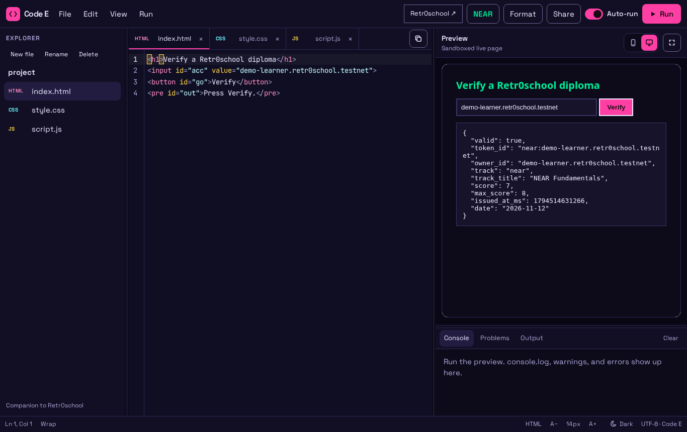
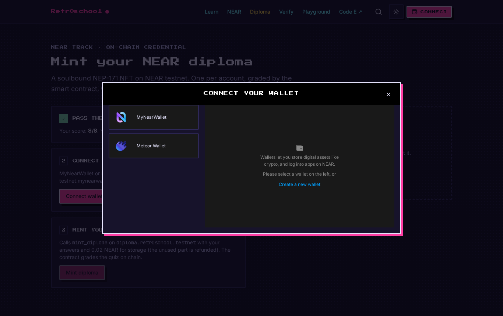
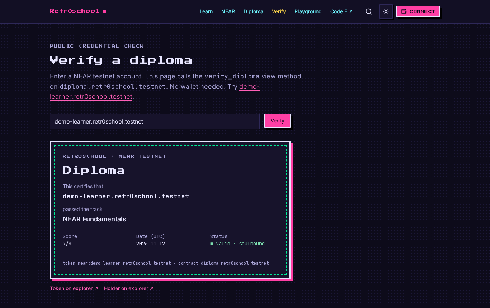

# Retr0school × Code E: the W3Schools of NEAR

Learn NEAR in short lessons, run every example in a browser playground, pass a quiz that a smart contract grades, and mint a **soulbound NEP-171 diploma NFT** on NEAR testnet that anyone can verify.

Built at **NEAR HACKATHON** (Nov 2026). Primary track: **NFTs That Do Something** (`nfts`): the NFT is a credential.

| | |
| --- | --- |
| Retr0school (learn, mint, verify) | https://retr0school-near.vercel.app |
| Code E (playground) | https://code-e-near.vercel.app |
| Diploma contract (testnet) | [`diploma.retr0school.testnet`](https://testnet.nearblocks.io/address/diploma.retr0school.testnet) |
| Example mint transaction | [`GXiQ74MBbT2hupFejvPVguUCJZ46WJ3prihXGWhP2Y4S`](https://testnet.nearblocks.io/txns/GXiQ74MBbT2hupFejvPVguUCJZ46WJ3prihXGWhP2Y4S) |
| Example verified diploma | https://retr0school-near.vercel.app/verify?account=demo-learner.retr0school.testnet |

## The problem

Web3 courses end with a PDF certificate or a badge on a private database. Neither proves anything: it can be faked, it can be sold, and nobody can check it without trusting the issuer. Beginners also bounce between docs, a code editor, and a wallet without a clear path.

## What we built

1. **A NEAR track in Retr0school** (`/near`): 9 MDX lessons (named accounts, access keys, gas & storage, view vs change calls, Wallet Selector, NEP-141, NEP-171, a first Rust contract, Intents & Chain Signatures) with live examples that call NEAR testnet RPC and the diploma contract.
2. **"Open in Code E"** on every NEAR example. The example opens in Code E (a separate playground app) through Code E's existing `#code=` share link. Code E also gets a **NEAR starter** template (`#template=near`): connect a testnet account and call `verify_diploma`.
3. **An 8-question quiz** (`/near/quiz`). Passing (6/8) unlocks the diploma page.
4. **The diploma contract** (`contracts/diploma`, Rust, near-sdk 5): NEP-171 + NEP-177 metadata + NEP-181 enumeration + NEP-297 events.
   - `mint_diploma(track, answers)` grades the answers **on chain** and mints only on a pass.
   - One diploma per account per track (token id `"{track}:{account}"`).
   - **Soulbound**: `nft_transfer` / `nft_transfer_call` always panic.
   - Token metadata `extra` holds JSON: `track`, `score`, `max_score`, `owner`, `issued_at_ms`, `date`.
   - `verify_diploma(account_id, track)` view method returns the credential or `null`.
   - Storage is paid by the learner (attach 0.02 NEAR, the unused part is refunded).
5. **Wallet Selector** (`@near-wallet-selector` v10, testnet, MyNearWallet + Meteor) with a Connect button styled like the rest of the retro UI.
6. **Diploma page** (`/diploma`): quiz status → connect → mint → diploma card + explorer link + public verify link.
7. **Public verify page** (`/verify?account=…`): anyone can check a credential with no wallet.

### How NEAR fits

- **Named accounts** make the credential human-readable: the diploma says `sina.testnet passed NEAR Fundamentals`, not a hex address.
- **NEP-171** makes it a standard NFT that wallets and explorers already understand, while the contract adds the behavior (on-chain grading, one-per-account, soulbound).
- **View calls** make verification free and wallet-less: an employer or another dApp calls `verify_diploma`.
- **Storage staking** is paid by the learner with a refunded deposit, so the issuer does not need a server or a treasury.

## Try it: steps for judges and AI screeners

No install needed. Testnet only.

1. Open https://retr0school-near.vercel.app → the hero says "Learn NEAR. Earn it on-chain." and the NEAR card is first in "Browse courses".
2. Open https://retr0school-near.vercel.app/near/view-vs-change-calls → press **Try it Yourself** or **Open in Code E ↗**, then **Verify** → you see the JSON credential of `demo-learner.retr0school.testnet` read from the contract (score 7/8).
3. Open https://code-e-near.vercel.app/#template=near → Code E loads the NEAR starter. Press **Connect**, then **Verify diploma** → the preview shows the account balance and "Valid diploma: NEAR Fundamentals, 7/8".
4. Open https://retr0school-near.vercel.app/verify?account=demo-learner.retr0school.testnet → a diploma card shows owner, score 7/8, date, "Valid · soulbound".
5. Open https://retr0school-near.vercel.app/near/quiz → answer all 8 questions, press **Score my quiz** → with 6+ correct you see "Passed. Your diploma is waiting." and a **Mint my diploma** link.
6. On `/diploma`, press **Connect wallet** → the Wallet Selector modal lists MyNearWallet and Meteor. Sign in with a testnet account (create one free at https://testnet.mynearwallet.com).
7. Press **Mint diploma** → approve the `mint_diploma` call (0.02 NEAR deposit, refunded except storage) → the diploma card appears with a **View mint transaction ↗** link to testnet NearBlocks and a public verify link.
8. Press **Mint diploma** again with the same account → the contract rejects it ("already holds a diploma"). Try `nft_transfer` from the CLI → it panics ("soulbound").

CLI check without the UI:

```bash
near contract call-function as-read-only diploma.retr0school.testnet verify_diploma \
  json-args '{"account_id":"demo-learner.retr0school.testnet","track":"near"}' network-config testnet now
near contract call-function as-read-only diploma.retr0school.testnet nft_tokens \
  json-args '{"from_index":"0","limit":10}' network-config testnet now
```

## Screenshots

Captured headlessly from the live deployments by `apps/retr0school/scripts/near-e2e.mjs` (9/9 checks pass).

| | |
| --- | --- |
| Home |  |
| Lesson with Open in Code E |  |
| Lesson example running in Code E |  |
| Code E NEAR starter |  |
| Quiz passed |  |
| Diploma page |  |
| Wallet Selector |  |
| Public verify page |  |

Re-run the checks:

```bash
cd apps/retr0school && npx playwright install chromium && node scripts/near-e2e.mjs
```

## Repository layout

```text
apps/retr0school/     Next.js 15 + MDX learning site (pre-existing app, NEAR work added)
  content/near/       NEW: NEAR track lessons + quiz.json
  components/near/    NEW: wallet provider, connect button, diploma flow, verify form, diploma card
  app/diploma, app/verify   NEW pages
  lib/near.ts, lib/code-e.ts NEW: RPC view calls, contract config, Code E links
apps/code-e/          Vite + TypeScript playground (pre-existing app, NEAR starter added)
  src/near-starter.ts NEW
contracts/diploma/    NEW: Rust NEP-171 diploma contract + unit tests
```

## Disclosure: what existed before the hackathon

Retr0school (HTML, CSS, JavaScript and Web3 tracks, lesson engine, playground, design) and Code E (the playground) are **pre-existing off-chain apps by the same author**, with no blockchain code. They were imported untouched in the first commit, tagged **`pre-hackathon-baseline`** (`0c86187`). Everything NEAR (the contract, wallet integration, NEAR lessons, quiz-to-mint flow, verify page, Code E NEAR starter and the cross-links) was built during the hackathon in later commits. See the diff:

```bash
git diff pre-hackathon-baseline..HEAD --stat
```

Once the repository is public on GitHub, the same diff is at `https://github.com/<owner>/<repo>/compare/pre-hackathon-baseline...main`.

Libraries used (Q-005): near-sdk / near-contract-standards 5.x, cargo-near, near-cli-rs, @near-wallet-selector 10.x (core, modal-ui, my-near-wallet, meteor-wallet), lz-string, Next.js, React, Vite, CodeMirror, Tailwind. Parts of the code were written with AI assistance.

Other NEAR HACKATHON project by the same author (Q-015): **TriagePay**, an independent project.

## Local development

Requirements: Node 20+, Rust 1.86+ with `wasm32-unknown-unknown`, `cargo-near`, `near-cli-rs`.

```bash
# contract
cd contracts/diploma
cargo test                                   # 11 unit tests
cargo near build non-reproducible-wasm       # -> target/near/retr0school_diploma.wasm

# Retr0school (http://localhost:43123)
cd apps/retr0school
npm ci
NEXT_PUBLIC_CODE_E_URL=http://localhost:5173 npm run dev
npm run build

# Code E
cd apps/code-e
npm ci
VITE_RETR0SCHOOL_URL=http://localhost:43123 npx vite --port 5173
npm run build
```

Configuration (all optional, defaults shown):

| Variable | App | Default |
| --- | --- | --- |
| `NEXT_PUBLIC_DIPLOMA_CONTRACT` | Retr0school | `diploma.retr0school.testnet` |
| `NEXT_PUBLIC_CODE_E_URL` | Retr0school | `https://code-e-near.vercel.app` |
| `NEXT_PUBLIC_SITE_URL` | Retr0school | `https://retr0school-near.vercel.app` |
| `NEXT_PUBLIC_NEAR_RPC` | Retr0school | `https://rpc.testnet.near.org` |
| `VITE_RETR0SCHOOL_URL` | Code E | `https://retr0school-near.vercel.app` |
| `VITE_DIPLOMA_CONTRACT` | Code E | `diploma.retr0school.testnet` |

## Deploy your own

```bash
# 1. testnet account from the faucet (keys go to your keychain, never the repo)
near account create-account sponsor-by-faucet-service my-diploma.testnet \
  autogenerate-new-keypair save-to-keychain network-config testnet create

# 2. deploy + init
cd contracts/diploma && cargo near build non-reproducible-wasm
near contract deploy my-diploma.testnet use-file target/near/retr0school_diploma.wasm \
  with-init-call new json-args '{"owner_id":"my-diploma.testnet","base_uri":null}' \
  prepaid-gas '100 Tgas' attached-deposit '0 NEAR' network-config testnet sign-with-keychain send

# 3. register the track (answer key = indexes of the correct options in content/near/quiz.json)
near contract call-function as-transaction my-diploma.testnet set_track \
  json-args '{"track_id":"near","title":"NEAR Fundamentals","answer_key":[1,1,2,0,3,1,1,0],"pass_score":6}' \
  prepaid-gas '30 Tgas' attached-deposit '0 NEAR' sign-as my-diploma.testnet network-config testnet sign-with-keychain send

# 4. web apps on Vercel
cd apps/code-e && vercel deploy --prod --build-env VITE_RETR0SCHOOL_URL=https://<your-retr0school>.vercel.app
cd apps/retr0school && vercel deploy --prod \
  --build-env NEXT_PUBLIC_CODE_E_URL=https://<your-code-e>.vercel.app \
  --build-env NEXT_PUBLIC_DIPLOMA_CONTRACT=my-diploma.testnet
```

## Contract API

| Method | Kind | Notes |
| --- | --- | --- |
| `new(owner_id, base_uri)` | init | |
| `set_track(track_id, title, answer_key, pass_score)` | change, owner | |
| `set_base_uri(base_uri)` | change, owner | media is `diploma/{track}.svg` relative to it |
| `mint_diploma(track, answers)` | change, payable | grades, mints to caller, refunds unused deposit |
| `verify_diploma(account_id, track)` | view | `{ valid, token_id, owner_id, track, track_title, score, max_score, issued_at_ms, date }` or `null` |
| `get_tracks()` | view | |
| `nft_token`, `nft_tokens`, `nft_tokens_for_owner`, `nft_supply_for_owner`, `nft_total_supply`, `nft_metadata` | view | NEP-171/177/181 |
| `nft_transfer`, `nft_transfer_call` | change | always panic (soulbound) |

Known limitation: the answer key is public on chain, so this is a learning credential, not a proctored exam. A future version could commit a hash of the key or rotate question pools.

## License

MIT, see [LICENSE](LICENSE).
