# Retr0 Academy × Code E on NEAR

Learn NEAR in short lessons, run every example in a browser playground, pass a quiz graded by a server whose answer key stays secret (the contract checks the grader's ed25519 signature), and mint a **soulbound NEP-171 diploma NFT** on NEAR testnet that anyone can verify.

Built at **NEAR HACKATHON** (Nov 2026). Primary track: **NFTs That Do Something** (`nfts`): the NFT is a credential.

| | |
| --- | --- |
| Retr0 Academy (learn, mint, verify) | https://retr0school-near.vercel.app |
| Code E (playground) | https://code-e-near.vercel.app |
| Diploma contract (testnet) | [`diploma.retr0school.testnet`](https://testnet.nearblocks.io/address/diploma.retr0school.testnet) |
| Example mint (signed grade, v2) | [`3bt1wodPU6bxW6qyenbU21Y2x74rETcx5ouoGpUkLUSZ`](https://testnet.nearblocks.io/txns/3bt1wodPU6bxW6qyenbU21Y2x74rETcx5ouoGpUkLUSZ) |
| Contract migration to v2 | [`3LfgR82sodd8D5V6TEwsvNJjaMCVoRDH3QJQFSX3NP5B`](https://testnet.nearblocks.io/txns/3LfgR82sodd8D5V6TEwsvNJjaMCVoRDH3QJQFSX3NP5B) |
| Shareable diploma (X card) | https://retr0school-near.vercel.app/d/hackathon-judge.retr0school.testnet |
| Diploma art (NFT media) | https://retr0school-near.vercel.app/api/diploma/near/hackathon-judge.retr0school.testnet |
| Leaderboard | https://retr0school-near.vercel.app/leaderboard |
| Holder-only Advanced NEAR | https://retr0school-near.vercel.app/advanced |
| Example verified diploma | https://retr0school-near.vercel.app/verify?account=hackathon-judge.retr0school.testnet |

## The problem

Web3 courses end with a PDF certificate or a badge on a private database. Neither proves anything: it can be faked, it can be sold, and nobody can check it without trusting the issuer. Beginners also bounce between docs, a code editor, and a wallet without a clear path.

## What we built

1. **A NEAR track in Retr0 Academy** (`/near`): 9 MDX lessons (named accounts, access keys, gas & storage, view vs change calls, Wallet Selector, NEP-141, NEP-171, a first Rust contract, Intents & Chain Signatures) with live examples that call NEAR testnet RPC and the diploma contract.
2. **"Open in Code E"** on every NEAR example. The example opens in Code E (a separate playground app) through Code E's existing `#code=` share link. Code E also gets a **NEAR starter** template (`#template=near`): connect a testnet account and call `verify_diploma`.
3. **An 8-question quiz** (`/near/quiz`), graded on the server. The answer key is a Vercel env var, never shipped to the browser or the chain. Passing (6/8) returns a signed grade and unlocks the diploma page.
4. **The diploma contract** (`contracts/diploma`, Rust, near-sdk 5): NEP-171 + NEP-177 metadata + NEP-181 enumeration + NEP-297 events.
   - `mint_diploma(track, score, max_score, expires_at_ms, signature)` mints only if the signature is a valid **ed25519 attestation from the registered grader** (`env::ed25519_verify`) over `retr0school-diploma|v1|{contract}|{caller}|{track}|{score}|{max}|{expires_ms}`, it has not expired (15 min), and the score is a pass. The caller's account is part of the signed message, so a grade cannot be edited or reused by someone else.
   - One diploma per account per track (token id `"{track}:{account}"`).
   - **Soulbound**: `nft_transfer` / `nft_transfer_call` always panic.
   - Token metadata `extra` holds JSON: `track`, `score`, `max_score`, `owner`, `issued_at_ms`, `date`. Token `media` points at the diploma art.
   - `verify_diploma(account_id, track)` view method returns the credential or `null`.
   - Storage is paid by the learner (attach 0.02 NEAR, the unused part is refunded).
5. **Wallet Selector** (`@near-wallet-selector` v10, testnet, MyNearWallet + Meteor) with a Connect button styled like the rest of the retro UI.
6. **Diploma page** (`/diploma`): quiz status → connect → mint → diploma card + explorer link + public verify link.
7. **Public verify page** (`/verify?account=…`): anyone can check a credential with no wallet.
8. **Neon diploma art** (`/api/diploma/{track}/{account}`): a 1200×630 retro PNG (rose/cyan neon, scanlines) with account, track, score and date, read live from the contract. It is the NFT `media` for new mints and the Open Graph / X card image.
9. **Share my diploma**: after minting and on the verify page, a button opens an X post prefilled with "… Built at NEAR HACKATHON @NEARProtocol #NEARHackathon" and the link `/d/{account}`, whose X card shows the art.
10. **Leaderboard** (`/leaderboard`): every holder, built from the contract's NEP-181 enumeration (`nft_total_supply` + `nft_tokens`), no indexer.
11. **Holder unlocks**: wallets that hold a diploma get a **Holder** badge in the header and the **Advanced NEAR** track (`/advanced`: cross-contract calls, storage staking deep dive, Chain Signatures basics, Intents in practice). Everyone else sees a locked teaser that links to the quiz.

### Architecture

```text
browser ──answers──▶ /api/grade (Vercel, key + ed25519 seed in env vars)
        ◀──{score, max, expires, signature}──
browser ──mint_diploma(track, score, max, expires, signature) via Wallet Selector──▶ diploma.retr0school.testnet
contract: ed25519_verify(attestor_pk, message bound to caller) → pass mark → one per account → mint soulbound NEP-171
site: verify_diploma / nft_tokens view calls → verify page, leaderboard, holder unlocks, diploma art
```

### How NEAR fits

- **Named accounts** make the credential human-readable: the diploma says `sina.testnet passed NEAR Fundamentals`, not a hex address.
- **NEP-171** makes it a standard NFT that wallets and explorers already understand, while the contract adds the behavior (verified grader signature, one-per-account, soulbound), and holding it unlocks content.
- **View calls** make verification free and wallet-less: an employer or another dApp calls `verify_diploma`.
- **Storage staking** is paid by the learner with a refunded deposit, so the issuer does not need a server or a treasury.

## Try it: steps for judges and AI screeners

No install needed. Testnet only.

1. Open https://retr0school-near.vercel.app → the hero says "Learn NEAR from scratch and graduate on-chain with Retr0 Academy." and the NEAR card is first in "Browse courses".
2. Open https://retr0school-near.vercel.app/near/view-vs-change-calls → press **Try it Yourself** or **Open in Code E ↗**, then **Verify** → you see the JSON credential of `demo-learner.retr0school.testnet` read from the contract (score 7/8).
3. Open https://code-e-near.vercel.app/#template=near → Code E loads the NEAR starter. Press **Connect**, then **Verify diploma** → the preview shows the account balance and "Valid diploma: NEAR Fundamentals, 7/8".
4. Open https://retr0school-near.vercel.app/verify?account=demo-learner.retr0school.testnet → a diploma card shows owner, score 7/8, date, "Valid · soulbound".
5. Open https://retr0school-near.vercel.app/near/quiz → answer all 8 questions, press **Score my quiz** → the server grades it (view source: no answers in the page). With 6+ correct you see "Passed. Your diploma is waiting." and a **Mint my diploma** link.
6. On `/diploma`, press **Connect wallet** → the Wallet Selector modal lists MyNearWallet and Meteor. Sign in with a testnet account (create one free at https://testnet.mynearwallet.com).
7. Press **Mint diploma** → approve the `mint_diploma` call (0.02 NEAR deposit, refunded except storage) → the diploma card appears with the neon art, a **View mint transaction ↗** link to testnet NearBlocks, **Share my diploma** (X) and a link to Advanced NEAR. The header shows **Holder**.
8. Open https://retr0school-near.vercel.app/advanced → with the holder wallet connected the 4 lessons open; without one you see the locked teaser.
9. Open https://retr0school-near.vercel.app/leaderboard → every diploma on the contract, newest data from `nft_tokens`.
10. Open https://retr0school-near.vercel.app/d/hackathon-judge.retr0school.testnet → the shareable page; its `og:image` / `twitter:image` is the diploma art. **Share my diploma** opens `x.com/intent/tweet` with #NEARHackathon @NEARProtocol.
11. Press **Mint diploma** again with the same account → the contract rejects it ("already holds a diploma"). Try `nft_transfer` from the CLI → it panics ("soulbound"). Call `mint_diploma` with a made-up score or someone else's signature → "Invalid grader signature" (both cases were sent on testnet and rejected; see the [judge account history](https://testnet.nearblocks.io/address/hackathon-judge.retr0school.testnet) and the demo-learner account).

CLI check without the UI:

```bash
near contract call-function as-read-only diploma.retr0school.testnet verify_diploma \
  json-args '{"account_id":"demo-learner.retr0school.testnet","track":"near"}' network-config testnet now
near contract call-function as-read-only diploma.retr0school.testnet nft_tokens \
  json-args '{"from_index":"0","limit":10}' network-config testnet now
near contract call-function as-read-only diploma.retr0school.testnet get_attestor json-args '{}' network-config testnet now

# full CLI mint: get a signed grade, then mint with it (the account must be yours)
curl -s https://retr0school-near.vercel.app/api/grade -H 'content-type: application/json' \
  -d '{"track":"near","accountId":"you.testnet","answers":[...8 option indexes...]}'
# -> {"score":8,"max_score":8,"passed":true,"attestation":{"track":"near","score":8,"max_score":8,"expires_at_ms":<ms>,"signature":"…"}}
near contract call-function as-transaction diploma.retr0school.testnet mint_diploma \
  json-args '{"track":"near","score":8,"max_score":8,"expires_at_ms":<ms>,"signature":"…"}' \
  prepaid-gas '100 Tgas' attached-deposit '0.02 NEAR' sign-as you.testnet network-config testnet sign-with-keychain send
```

## Screenshots

Captured headlessly from the live deployments by `apps/retr0school/scripts/near-e2e.mjs` (17/17 checks pass). The holder screenshots use a read-only simulated MyNearWallet session for `hackathon-judge.retr0school.testnet` (no keys); the unlock itself comes from the on-chain `verify_diploma` check.

| | |
| --- | --- |
| Home | 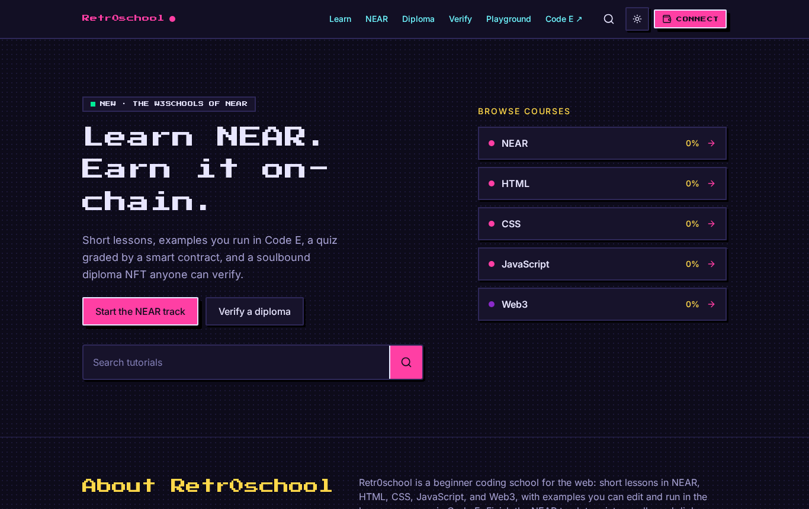 |
| Lesson with Open in Code E | 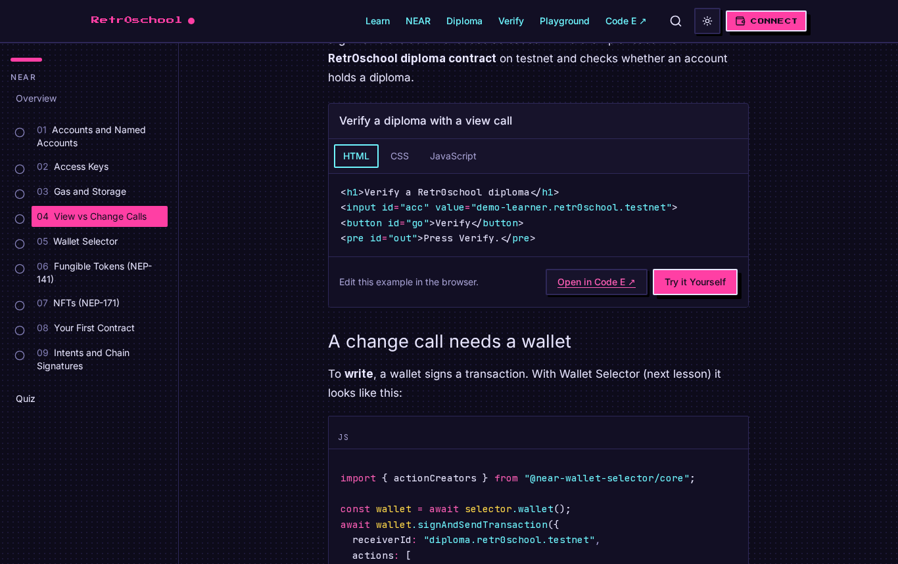 |
| Lesson example running in Code E |  |
| Code E NEAR starter | 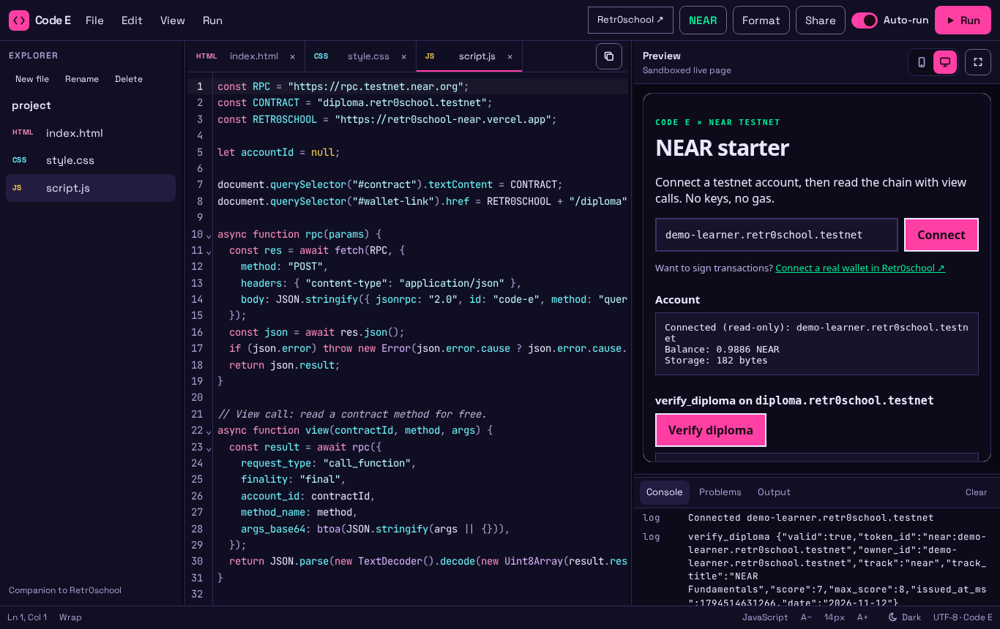 |
| Quiz passed | 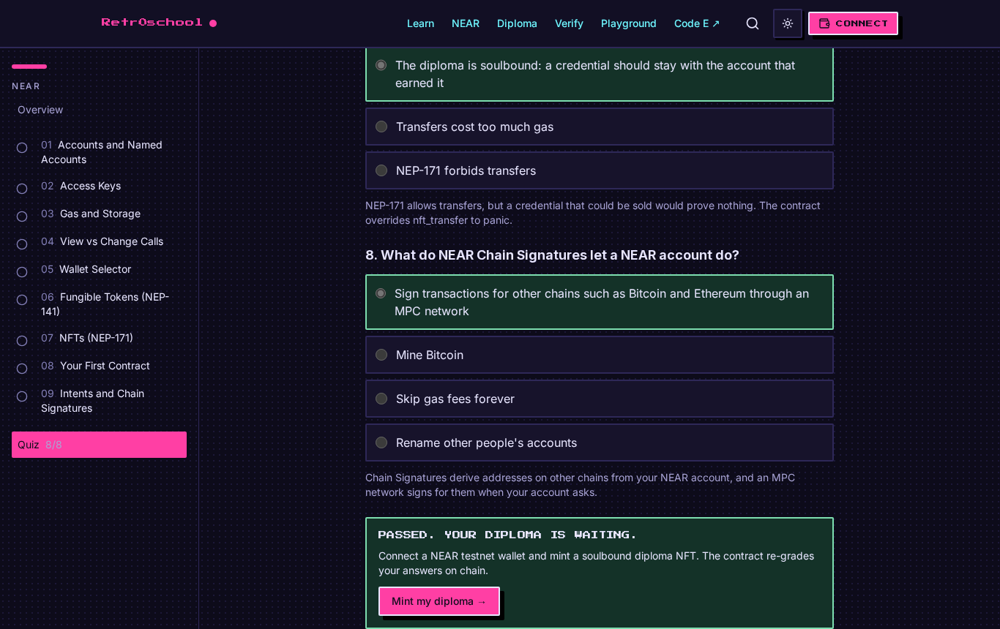 |
| Diploma page | 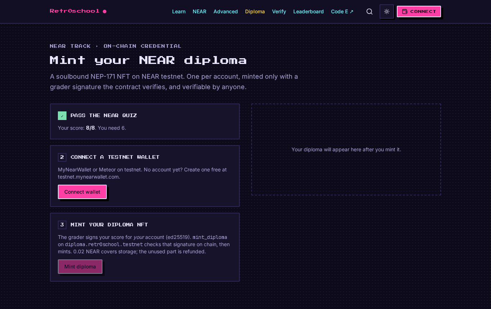 |
| Wallet Selector |  |
| Public verify page |  |
| Leaderboard | 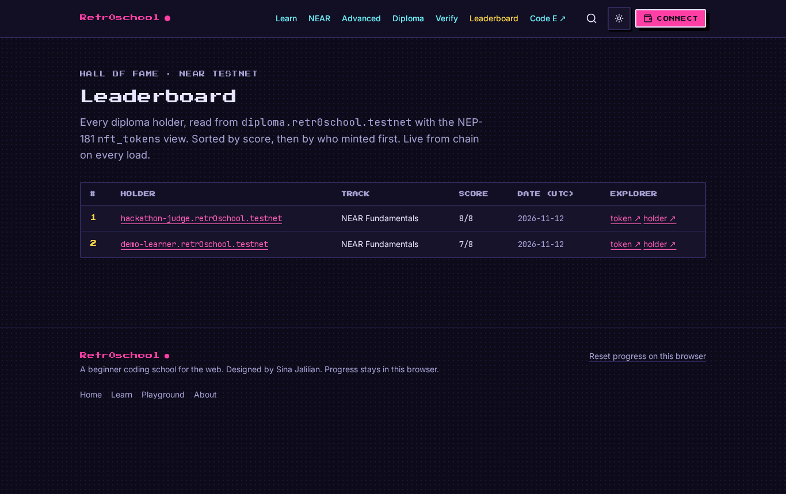 |
| Diploma art (NFT media) | 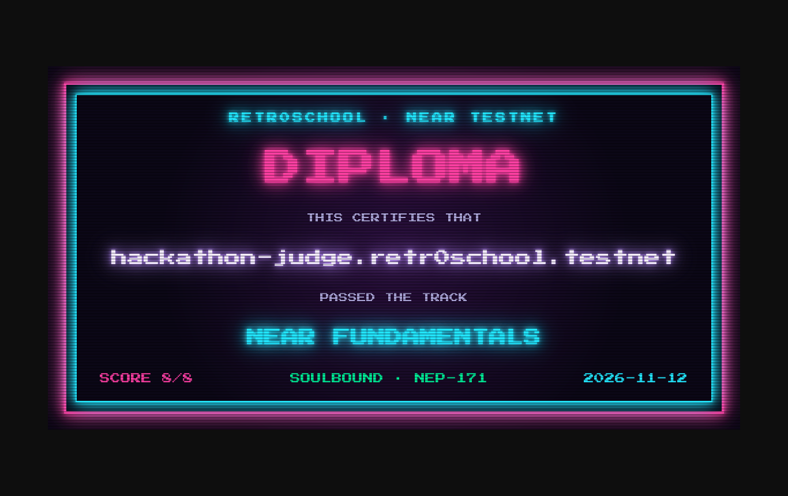 |
| Share page + X card | 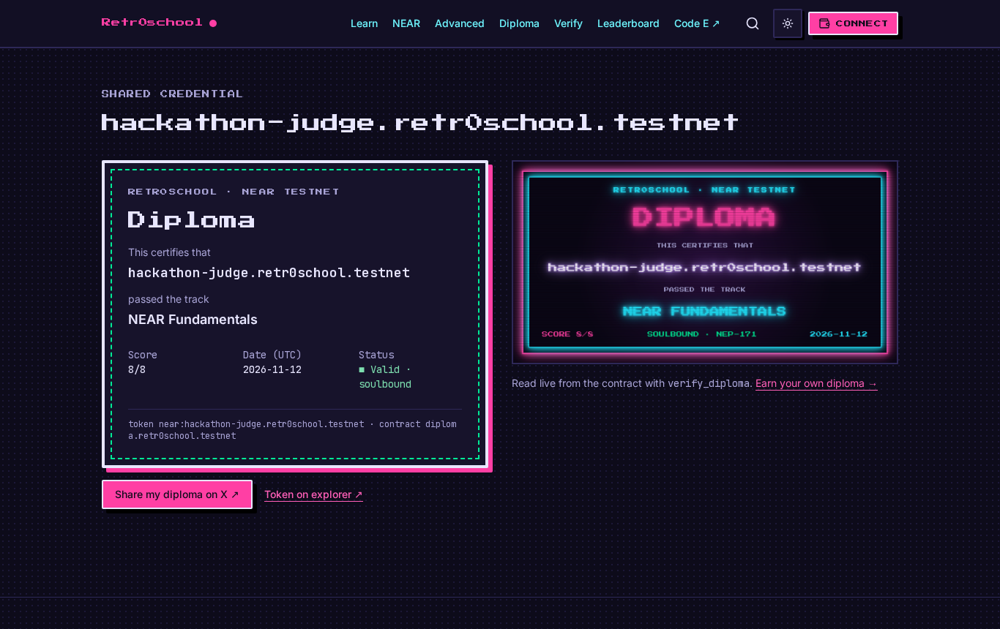 |
| Advanced NEAR, locked | 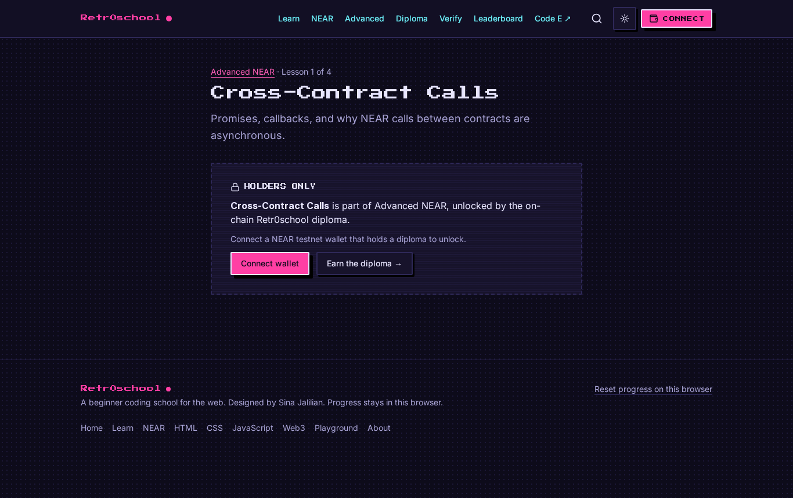 |
| Advanced NEAR, holder view + badge | 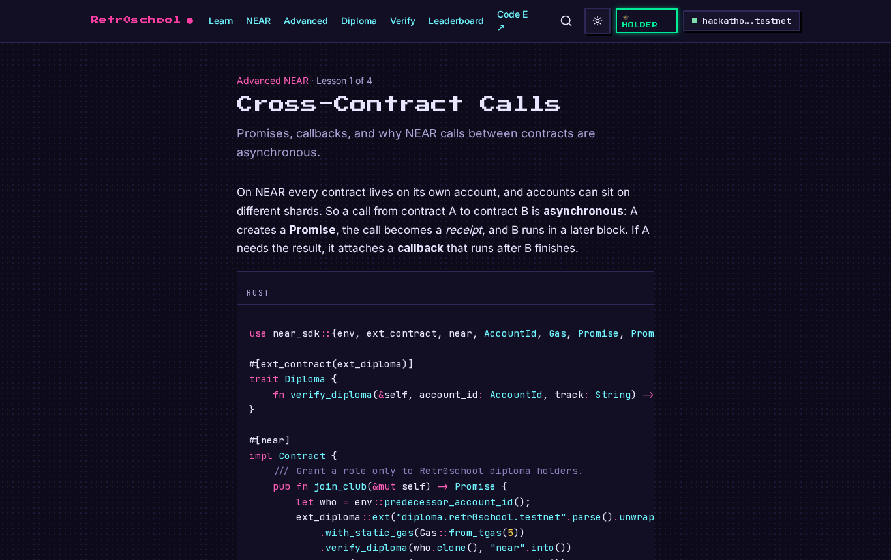 |
| Diploma page as holder (share) | 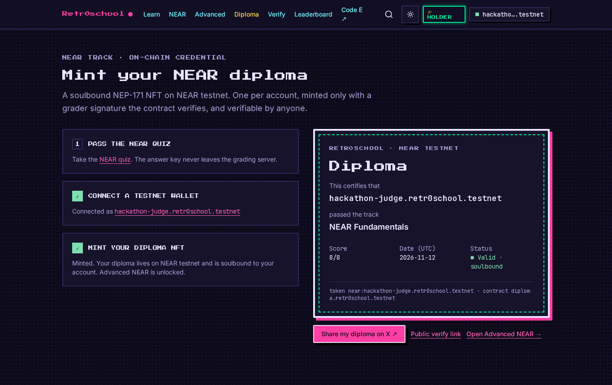 |

Re-run the checks:

```bash
cd apps/retr0school && npx playwright install chromium
NEAR_QUIZ_ANSWER_KEY=<the grader's key> node scripts/near-e2e.mjs   # without the key the "passed" step is skipped
```

## Repository layout

```text
apps/retr0school/     Next.js 15 + MDX learning site (pre-existing app, NEAR work added)
  content/near/       NEW: NEAR track lessons + quiz.json
  content-advanced/   NEW: holder-only Advanced NEAR lessons
  components/near/    NEW: wallet provider, connect button, diploma flow, verify form, diploma card,
                      share button, holder gate + badge
  app/diploma, app/verify, app/leaderboard, app/advanced, app/d/[account]   NEW pages
  app/api/grade       NEW: server grader, signs ed25519 attestations
  app/api/diploma     NEW: neon diploma art (PNG, next/og, Press Start 2P under OFL)
  lib/near.ts, lib/grader.ts, lib/diploma-art.tsx, lib/code-e.ts   NEW
apps/code-e/          Vite + TypeScript playground (pre-existing app, NEAR starter added)
  src/near-starter.ts NEW
contracts/diploma/    NEW: Rust NEP-171 diploma contract + unit tests
```

## Disclosure: what existed before the hackathon

Retr0 Academy (HTML, CSS, JavaScript and Web3 tracks, lesson engine, playground, design) and Code E (the playground) are **pre-existing off-chain apps by the same author**, with no blockchain code. They were imported untouched in the first commit, tagged **`pre-hackathon-baseline`** (`0c86187`). Everything NEAR (the contract, server grader, wallet integration, NEAR and Advanced NEAR lessons, quiz-to-mint flow, verify page, leaderboard, diploma art and sharing, Code E NEAR starter and the cross-links) was built during the hackathon in later commits. See the diff:

```bash
git diff pre-hackathon-baseline..HEAD --stat
```

Once the repository is public on GitHub, the same diff is at `https://github.com/<owner>/<repo>/compare/pre-hackathon-baseline...main`.

Libraries used (Q-005): near-sdk / near-contract-standards 5.x, cargo-near, near-cli-rs, @near-wallet-selector 10.x (core, modal-ui, my-near-wallet, meteor-wallet), lz-string, Next.js (incl. `next/og`), React, Vite, CodeMirror, Tailwind, ed25519-dalek (contract tests only), Press Start 2P font (SIL OFL). Parts of the code were written with AI assistance.


## Local development

Requirements: Node 20+, Rust 1.86+ with `wasm32-unknown-unknown`, `cargo-near`, `near-cli-rs`.

```bash
# contract
cd contracts/diploma
cargo test                                   # 18 unit tests
cargo near build non-reproducible-wasm       # -> target/near/retr0school_diploma.wasm

# Retr0 Academy (http://localhost:43123)
cd apps/retr0school
npm ci
NEXT_PUBLIC_CODE_E_URL=http://localhost:5173 npm run dev
npm run build

# Code E
cd apps/code-e
npm ci
VITE_RETR0SCHOOL_URL=http://localhost:43123 npx vite --port 5173
npm run build
```

Configuration (all optional, defaults shown):

| Variable | App | Default |
| --- | --- | --- |
| `NEXT_PUBLIC_DIPLOMA_CONTRACT` | Retr0 Academy | `diploma.retr0school.testnet` |
| `NEXT_PUBLIC_CODE_E_URL` | Retr0 Academy | `https://code-e-near.vercel.app` |
| `NEXT_PUBLIC_SITE_URL` | Retr0 Academy | `https://retr0school-near.vercel.app` |
| `NEXT_PUBLIC_NEAR_RPC` | Retr0 Academy | `https://rpc.testnet.near.org` |
| `NEAR_ATTESTOR_SEED` | Retr0 Academy (server, secret) | none: 32-byte ed25519 seed, hex |
| `NEAR_QUIZ_ANSWER_KEY` | Retr0 Academy (server, secret) | none: comma-separated correct option indexes |
| `VITE_RETR0SCHOOL_URL` | Code E | `https://retr0school-near.vercel.app` |
| `VITE_DIPLOMA_CONTRACT` | Code E | `diploma.retr0school.testnet` |

## Deploy your own

```bash
# 1. testnet account from the faucet (keys go to your keychain, never the repo)
near account create-account sponsor-by-faucet-service my-diploma.testnet \
  autogenerate-new-keypair save-to-keychain network-config testnet create

# 2. deploy + init
cd contracts/diploma && cargo near build non-reproducible-wasm
near contract deploy my-diploma.testnet use-file target/near/retr0school_diploma.wasm \
  with-init-call new json-args '{"owner_id":"my-diploma.testnet","base_uri":null}' \
  prepaid-gas '100 Tgas' attached-deposit '0 NEAR' network-config testnet sign-with-keychain send

# 3. grader key: a fresh ed25519 keypair (keep the seed secret)
node -e "const c=require('crypto');const k=c.generateKeyPairSync('ed25519');const d=k.privateKey.export({format:'der',type:'pkcs8'});const p=k.publicKey.export({format:'der',type:'spki'});console.log('seed',d.subarray(-32).toString('hex'));console.log('pub',p.subarray(-32).toString('base64'))"
# convert pub to base58 and register it as ed25519:<base58>
near contract call-function as-transaction my-diploma.testnet set_attestor \
  json-args '{"public_key":"ed25519:<base58 pub>"}' \
  prepaid-gas '30 Tgas' attached-deposit '0 NEAR' sign-as my-diploma.testnet network-config testnet sign-with-keychain send

# 4. register the track (only the question count and pass mark go on chain)
near contract call-function as-transaction my-diploma.testnet set_track \
  json-args '{"track_id":"near","title":"NEAR Fundamentals","questions":8,"pass_score":6}' \
  prepaid-gas '30 Tgas' attached-deposit '0 NEAR' sign-as my-diploma.testnet network-config testnet sign-with-keychain send

# 5. web apps on Vercel (set the two grader secrets first)
cd apps/code-e && vercel deploy --prod --build-env VITE_RETR0SCHOOL_URL=https://<your-retr0school>.vercel.app
cd apps/retr0school && vercel env add NEAR_ATTESTOR_SEED production && vercel env add NEAR_QUIZ_ANSWER_KEY production
vercel deploy --prod \
  --build-env NEXT_PUBLIC_CODE_E_URL=https://<your-code-e>.vercel.app \
  --build-env NEXT_PUBLIC_DIPLOMA_CONTRACT=my-diploma.testnet
```

## Contract API

| Method | Kind | Notes |
| --- | --- | --- |
| `new(owner_id, base_uri)` | init | |
| `set_track(track_id, title, questions, pass_score)` | change, owner | |
| `set_attestor(public_key)` / `get_attestor()` | change, owner / view | ed25519 key of the grader |
| `set_base_uri(base_uri)` | change, owner | media is `{base_uri}/api/diploma/{track}/{account}` |
| `mint_diploma(track, score, max_score, expires_at_ms, signature)` | change, payable | verifies the grader signature + expiry + pass mark, mints to caller, refunds unused deposit |
| `migrate(attestor_public_key)` | private init | v1 → v2 state migration, keeps existing diplomas |
| `verify_diploma(account_id, track)` | view | `{ valid, token_id, owner_id, track, track_title, score, max_score, issued_at_ms, date }` or `null` |
| `get_tracks()` | view | |
| `nft_token`, `nft_tokens`, `nft_tokens_for_owner`, `nft_supply_for_owner`, `nft_total_supply`, `nft_metadata` | view | NEP-171/177/181 |
| `nft_transfer`, `nft_transfer_call` | change | always panic (soulbound) |

The contract was upgraded in place from v1 (answer key stored on chain) to v2 (signed grades): same account id, existing diplomas kept, the quiz options were reshuffled so the old public key no longer passes.

Known limitations: the grader has no rate limiting, so it is still a learning credential, not a proctored exam; the Advanced NEAR unlock is checked in the browser against the connected wallet (the lesson text is in the page), not gated by a wallet signature on the server.

## License

MIT, see [LICENSE](LICENSE).
